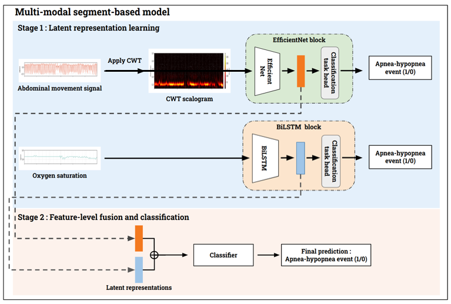

# A Multi-Modal Deep Learning Framework for Automated Home-Based Sleep Apnea Detection

Master's thesis project. The goal is to estimate sleep apnea severity (AHI category) from a small set of signals that a home sleep test can record, instead of a full in-lab polysomnography (PSG).

> 📬 **Source code is not publicly available.** The project uses clinical sleep datasets under data use agreements, and parts of the analysis contain participant-level results, so the code is kept in a private repository.
> For recruitment or academic purposes, please contact: **luo25personal@gmail.com**

> The implementation is a fork of [DRIVEN](https://github.com/LCSB-SCG/DRIVEN) (LCSB-SCG), released under the Academic Software Licence (ASL). The sections below describe what I extended and added on top of the original framework.

---

## Overview

The model uses two stages:

- **Stage 1: Latent representation learning.** A separate feature-extraction network is trained for each signal modality.
  - **Abdominal movement:** the signal is converted to a 2D scalogram with the continuous wavelet transform (CWT), then encoded by an **EfficientNet**.
  - **Oxygen saturation (SpO₂):** the raw time series is encoded by a **BiLSTM**.
- **Stage 2: Feature-level fusion and classification.** The latent representations from each branch are concatenated and passed to multiple classifiers, which predict apnea-hypopnea events per segment.

Segment-level predictions are then aggregated over the night to estimate the AHI. Each recording is classified into four severity levels: **Healthy (AHI < 5), Mild (5–15), Moderate (15–30), Severe (≥ 30)**.

## Data

- Polysomnography recordings from the **National Sleep Research Resource (NSRR)**, including the MESA and SHHS cohorts.
- The data are used under the NSRR data use agreement and **are not redistributed** in any form.

## My contributions

Compared with the original framework, I added or reworked the following:

- Built a data quality-control and preprocessing pipeline, including continuous wavelet transform (CWT) to convert abdominal movement signals into 2D time-frequency scalograms
- Designed new feature-extraction branches (EfficientNet on CWT scalograms, BiLSTM for SpO₂)
- Benchmarked multiple classifiers (LightGBM, XGBoost, CatBoost, Random Forest, TabPFN, TabNet) with Optuna hyperparameter search
- Evaluated the models with bootstrap confidence intervals, statistical significance tests and subgroup analysis
- Analysed misclassified cases

## Tech stack

- **Python:** TensorFlow / Keras, scikit-learn, LightGBM, XGBoost, CatBoost, TabPFN, PyTorch TabNet, Optuna, NumPy, pandas, h5py
- **MATLAB R2021a:** PSG preprocessing and windowing (PSG → HDF5)
- **Analysis:** Jupyter, Matplotlib, SciPy

## Licence

The original DRIVEN framework is © 2024 University of Luxembourg and is distributed under the Academic Software Licence v1.0 (ASL), which permits academic non-commercial use only. My modifications are licensed under the same terms.

---

📬 To request the code or discuss the work, please contact **luo25personal@gmail.com**
